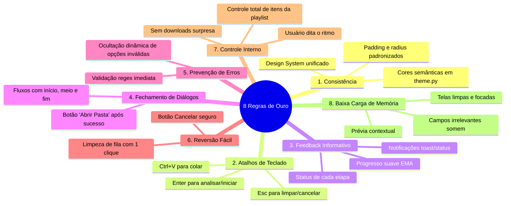

# 📐 NexusFetch — Desktop UI/UX & Design Guidelines

Este documento define as regras e diretrizes permanentes de **UI/UX para software desktop/executável** no âmbito do repositório **NexusFetch**. Toda nova tela, componente, refatoração ou teste automatizado de interface deve seguir estritamente estes princípios.

---

## 🖥️ 1. As 4 Diretrizes Centrais para Softwares Desktop

### 1.1 Desktop UI Guidelines (Padrões de Sistema e Framework)
- **Framework Oficial:** Toda a interface gráfica deve ser construída exclusivamente com **CustomTkinter** / **Tkinter** nativo.
- **Integração de Sistema:** Respeitar comportamentos de janelas e eventos dos sistemas alvo (**Windows 10/11** e **Linux X11/Wayland**), incluindo drag-and-drop nativo (`windnd` / `tkdnd`), foco de janela, renderização de DPI alto e atalhos de sistema.
- **Gerenciamento de Janelas e Containers:** Utilizar layout estruturado em containers (`CTkFrame`, `CTkScrollableFrame`) com padding padronizado, evitando sobreposição e garantindo redimensionamento responsivo.

### 1.2 Awesome Software Design (Hierarquia, Tipografia e Contraste)
- **Hierarquia Visual Estrita:** O olhar do usuário deve ser guiado em 3 níveis claros: 
  1. *Ação Primária / Entrada* (ex.: Barra de URL, Área de Drop, Botão principal de ação em destaque).
  2. *Configurações & Painéis* (ex.: Seletores de qualidade, listas de seleção, cartões de prévia).
  3. *Telemetria & Rodapé* (ex.: Barra de progresso, status, velocidade, ETA, ações secundárias).
- **Tipografia e Legibilidade:** Fontes de sistema modernas (`Segoe UI` no Windows, `Ubuntu` / `Noto Sans` no Linux), com diferenciação clara por pesos (`bold`, `normal`) e tamanhos proporcionais.
- **Contraste e Dark Mode:** Esquema de cores dark mode de alto contraste (fundo escuro neutro `#0D0D11` / `#16161D`, acentos contextuais de alto impacto: Vermelho YouTube `#E50914`, Roxo Conversor `#8B5CF6`). Todos os textos devem atender à proporção de contraste mínima WCAG AA (4.5:1).

### 1.3 Image to Native UI (Estritamente Nativo)
- **Proibição Absoluta de Webviews/HTML/CSS:** Qualquer mockup, captura de tela ou referência visual convertida em código DEVE gerar única e exclusivamente componentes nativos Python/CustomTkinter (`CTkButton`, `CTkLabel`, `CTkEntry`, `CTkProgressBar`, etc.).
- **Fidelidade de Conversão:** Respeitar pixels, cantos arredondados (`corner_radius`), espessura de borda (`border_width`), ícones vetoriais/rasterizados nativos via `CTkImage` e paletas de cores definidas em `src/ui/theme.py`.

### 1.4 Automação e Testes Desktop
- **Foco em Eventos e Estados Nativos:** Testes de interface automatizados devem simular ciclos de vida do framework (invocação de callbacks, alternância de estados, validação de widgets mapeados `winfo_ismapped()`, verificação de bindings de teclas e variáveis `StringVar`/`BooleanVar`).
- **Eliminação de Web-Scraping em Testes:** Nunca utilizar ferramentas ou drivers voltados para Web (Selenium, Puppeteer, BeautifulSoup) para testar a interface do aplicativo. Testar puramente a lógica do Tkinter e dos controladores de eventos em `tests/`.

---

## 🌟 2. As 8 Regras de Ouro de Ben Shneiderman Aplicadas ao NexusFetch

| Regra | Aplicação no NexusFetch |
|---|---|
| **1. Buscar Consistência** | Todas as abas seguem o mesmo layout de cabeçalho, barra de entrada/área de seleção, opções contextuais e barra de ação inferior padronizada em [[src/ui/theme.py]]. |
| **2. Permitir Atalhos para Frequentes** | Suporte a atalhos rápidos de teclado: `Ctrl+V` (focar e colar URL), `Enter` (analisar link / iniciar conversão), `Escape` (cancelar/limpar seleção), `Ctrl+A` / `Delete` na fila de arquivos. |
| **3. Feedback Informativo** | Cada ação fornece resposta visual imediata: barra de progresso suave com filtro EMA para evitar saltos, porcentagem precisa, telemetria real (MB/s ou multiplicador de velocidade `x.xx`), e status detalhado da operação FFmpeg em tempo real. |
| **4. Fechar Diálogos com Clareza** | Finalização clara do fluxo de trabalho: mudança do status para mensagem de sucesso verde, liberação do botão destacado de "Abrir Pasta" direcionando ao arquivo gerado, e retorno seguro para o estado inicial. |
| **5. Prevenção e Tratamento Simples de Erros** | Validação prévia de links antes do download via [[src/utils/validators.py]], ocultação dinâmica de opções inválidas (ex: esconder resolução e codecs quando áudio for o destino), tratamento de nomes com caracteres especiais/Unicode, e gravação atômica (`.tmp`) contra corrupção. |
| **6. Reversão Fácil de Ações (Undo)** | Capacidade de interromper downloads ou conversões a qualquer momento via botão "Cancelar" sem travar a interface e limpando restos temporários. Botão "Limpar Todos" para resetar a fila com facilidade. |
| **7. Apoiar o Controle Interno do Usuário** | O usuário mantém total autonomia: seleção manual e seletiva de vídeos em playlists via paginação, escolha explícita de resolução e codec, personalização da pasta de destino e controle de cancelamento em tempo real. |
| **8. Reduzir a Carga de Memória de Curto Prazo** | Interface limpa e minimalista: elementos desnecessários não poluem a tela (seletor de codec e resolução desaparecem quando irrelevantes), resumo imediato das propriedades do arquivo selecionado e persistência da última pasta utilizada. |

---

## 🔗 3. Grafo de Relações de UI no Código

- Controlador Principal de Telas e Navegação: [[src/ui/app.py]]
- Paleta de Cores, Fontes e Constantes de Design: [[src/ui/theme.py]]
- Barra Superior e Troca de Módulos: [[src/ui/components/navbar.py]]
- Módulo de Conversor Multimídia (Batch / GPU): [[src/ui/components/converter_view.py]]
- Barra de Inserção de URL e Feedback: [[src/ui/components/url_input.py]]
- Card de Prévia e Visualização de Playlists: [[src/ui/components/preview.py]]
- Barra de Formatos e Botões de Download: [[src/ui/components/format_bar.py]]
- Motor de Conversão e Encoders: [[src/core/converter.py]]
- Suíte de Testes Nativos: [[tests/test_converter.py]] e [[tests/test_downloader.py]]
