# Project Graph (v2.0)

> [!NOTE]
> Mapa estrutural e semântico para Obsidian e Otimização de Tokens do Antigravity.
> **Atualizado em**: 2026-11-23 10:14:46 | **Stack**: Python | **Arquivos Indexados**: 57
> **Legenda de Certeza**: `-->` Confirmada | `-.->` Inferida | `⚠️` Dependência Dinâmica/Desconhecida (exige validação no código).

## 1. Índice Estrutural (Visão Rápida)

- **Pontos de Entrada**: [[build.bat]], [[build_exe.py]], [[build_linux.py]], [[build_linux.sh]], [[build_linux_via_wsl.bat]], [[gpg_pass.bat]], [[main.py]], [[src/__init__.py]], [[src/core/__init__.py]], [[src/ui/__init__.py]], [[src/ui/components/__init__.py]], [[src/utils/__init__.py]]
- **⚠️ Zona Cega / Conexões Dinâmicas (21)**: [[build_exe.py]], [[build_linux.py]], [[src/core/compressor.py]], [[src/core/converter.py]], [[src/core/downloader.py]], [[src/core/metadata.py]], [[src/core/trimmer.py]], [[src/ui/app.py]], [[src/ui/components/compressor_view.py]], [[src/ui/components/converter_view.py]], [[src/ui/components/multi_download_view.py]], [[src/ui/components/progress.py]], [[src/ui/components/trimmer_view.py]], [[src/utils/diagnostics.py]], [[src/utils/logger.py]]
- **Dependências Externas**: `PIL`, `PyInstaller`, `ctypes`, `curl_cffi`, `customtkinter`, `dataclasses`, `datetime`, `enum`, `glob`, `html`, `importlib`, `io`, `json`, `logging`, `math`, `os`, `pathlib`, `pytest`, `queue`, `re`, `shutil`, `socket`, `src`, `ssl`, `subprocess`

## 2. Grafo de Relacionamentos (Mermaid.js)

```mermaid
graph TD
    classDef default fill:#1e1e2e,stroke:#89b4fa,stroke-width:1px,color:#cdd6f4;
    classDef dynamic fill:#312229,stroke:#f9e2af,stroke-width:2px,color:#f9e2af;
    n_main_py["[[main.py]]"] --> n_src_ui_app_py["[[src/ui/app.py]] ⚠️"]
    n_main_py["[[main.py]]"] --> n_src_utils_updater_py["[[src/utils/updater.py]] ⚠️"]
    n_src_core_compressor_py["[[src/core/compressor.py]] ⚠️"] --> n_src_core_converter_py["[[src/core/converter.py]] ⚠️"]
    n_src_core_compressor_py["[[src/core/compressor.py]] ⚠️"] --> n_src_utils_helpers_py["[[src/utils/helpers.py]]"]
    n_src_core_compressor_py["[[src/core/compressor.py]] ⚠️"] --> n_src_utils_logger_py["[[src/utils/logger.py]] ⚠️"]
    n_src_core_converter_py["[[src/core/converter.py]] ⚠️"] --> n_src_utils_diagnostics_py["[[src/utils/diagnostics.py]] ⚠️"]
    n_src_core_converter_py["[[src/core/converter.py]] ⚠️"] --> n_src_utils_helpers_py["[[src/utils/helpers.py]]"]
    n_src_core_converter_py["[[src/core/converter.py]] ⚠️"] --> n_src_utils_logger_py["[[src/utils/logger.py]] ⚠️"]
    n_src_core_downloader_py["[[src/core/downloader.py]] ⚠️"] --> n_src_utils_diagnostics_py["[[src/utils/diagnostics.py]] ⚠️"]
    n_src_core_downloader_py["[[src/core/downloader.py]] ⚠️"] --> n_src_utils_helpers_py["[[src/utils/helpers.py]]"]
    n_src_core_downloader_py["[[src/core/downloader.py]] ⚠️"] --> n_src_utils_logger_py["[[src/utils/logger.py]] ⚠️"]
    n_src_core_metadata_py["[[src/core/metadata.py]] ⚠️"] --> n_src_utils_diagnostics_py["[[src/utils/diagnostics.py]] ⚠️"]
    n_src_core_metadata_py["[[src/core/metadata.py]] ⚠️"] --> n_src_utils_helpers_py["[[src/utils/helpers.py]]"]
    n_src_core_metadata_py["[[src/core/metadata.py]] ⚠️"] --> n_src_utils_logger_py["[[src/utils/logger.py]] ⚠️"]
    n_src_core_metadata_py["[[src/core/metadata.py]] ⚠️"] --> n_src_utils_validators_py["[[src/utils/validators.py]]"]
    n_src_core_trimmer_py["[[src/core/trimmer.py]] ⚠️"] --> n_src_core_converter_py["[[src/core/converter.py]] ⚠️"]
    n_src_core_trimmer_py["[[src/core/trimmer.py]] ⚠️"] --> n_src_utils_helpers_py["[[src/utils/helpers.py]]"]
    n_src_core_trimmer_py["[[src/core/trimmer.py]] ⚠️"] --> n_src_utils_logger_py["[[src/utils/logger.py]] ⚠️"]
    n_src_core_trimmer_py["[[src/core/trimmer.py]] ⚠️"] --> n_src_utils_validators_py["[[src/utils/validators.py]]"]
    n_src_ui_app_py["[[src/ui/app.py]] ⚠️"] --> n_src_config_py["[[src/config.py]]"]
    n_src_ui_app_py["[[src/ui/app.py]] ⚠️"] --> n_src_core_downloader_py["[[src/core/downloader.py]] ⚠️"]
    n_src_ui_app_py["[[src/ui/app.py]] ⚠️"] --> n_src_core_metadata_py["[[src/core/metadata.py]] ⚠️"]
    n_src_ui_app_py["[[src/ui/app.py]] ⚠️"] --> n_src_ui_components_compressor_view_py["[[src/ui/components/compressor_view.py]] ⚠️"]
    n_src_ui_app_py["[[src/ui/app.py]] ⚠️"] --> n_src_ui_components_converter_view_py["[[src/ui/components/converter_view.py]] ⚠️"]
    n_src_ui_app_py["[[src/ui/app.py]] ⚠️"] --> n_src_ui_components_diag_modal_py["[[src/ui/components/diag_modal.py]]"]
    n_src_ui_app_py["[[src/ui/app.py]] ⚠️"] --> n_src_ui_components_format_bar_py["[[src/ui/components/format_bar.py]]"]
    n_src_ui_app_py["[[src/ui/app.py]] ⚠️"] --> n_src_ui_components_multi_download_view_py["[[src/ui/components/multi_download_view.py]] ⚠️"]
    n_src_ui_app_py["[[src/ui/app.py]] ⚠️"] --> n_src_ui_components_navbar_py["[[src/ui/components/navbar.py]]"]
    n_src_ui_app_py["[[src/ui/app.py]] ⚠️"] --> n_src_ui_components_preview_py["[[src/ui/components/preview.py]]"]
    n_src_ui_app_py["[[src/ui/app.py]] ⚠️"] --> n_src_ui_components_progress_py["[[src/ui/components/progress.py]] ⚠️"]
    n_src_ui_app_py["[[src/ui/app.py]] ⚠️"] --> n_src_ui_components_trimmer_view_py["[[src/ui/components/trimmer_view.py]] ⚠️"]
    n_src_ui_app_py["[[src/ui/app.py]] ⚠️"] --> n_src_ui_components_url_input_py["[[src/ui/components/url_input.py]]"]
    n_src_ui_app_py["[[src/ui/app.py]] ⚠️"] --> n_src_ui_theme_py["[[src/ui/theme.py]]"]
    n_src_ui_app_py["[[src/ui/app.py]] ⚠️"] --> n_src_utils_diagnostics_py["[[src/utils/diagnostics.py]] ⚠️"]
    n_src_ui_app_py["[[src/ui/app.py]] ⚠️"] --> n_src_utils_logger_py["[[src/utils/logger.py]] ⚠️"]
    n_src_ui_app_py["[[src/ui/app.py]] ⚠️"] --> n_src_utils_notifications_py["[[src/utils/notifications.py]] ⚠️"]
    n_src_ui_app_py["[[src/ui/app.py]] ⚠️"] --> n_src_utils_settings_py["[[src/utils/settings.py]]"]
    n_src_ui_app_py["[[src/ui/app.py]] ⚠️"] --> n_src_utils_updater_py["[[src/utils/updater.py]] ⚠️"]
    n_src_ui_components_compressor_view_py["[[src/ui/components/compressor_view.py]] ⚠️"] --> n_src_core_compressor_py["[[src/core/compressor.py]] ⚠️"]
    n_src_ui_components_compressor_view_py["[[src/ui/components/compressor_view.py]] ⚠️"] --> n_src_core_converter_py["[[src/core/converter.py]] ⚠️"]
    n_src_ui_components_compressor_view_py["[[src/ui/components/compressor_view.py]] ⚠️"] --> n_src_ui_theme_py["[[src/ui/theme.py]]"]
    n_src_ui_components_compressor_view_py["[[src/ui/components/compressor_view.py]] ⚠️"] --> n_src_utils_notifications_py["[[src/utils/notifications.py]] ⚠️"]
    n_src_ui_components_compressor_view_py["[[src/ui/components/compressor_view.py]] ⚠️"] --> n_src_utils_settings_py["[[src/utils/settings.py]]"]
    n_src_ui_components_converter_view_py["[[src/ui/components/converter_view.py]] ⚠️"] --> n_src_config_py["[[src/config.py]]"]
    n_src_ui_components_converter_view_py["[[src/ui/components/converter_view.py]] ⚠️"] --> n_src_core_converter_py["[[src/core/converter.py]] ⚠️"]
    n_src_ui_components_converter_view_py["[[src/ui/components/converter_view.py]] ⚠️"] --> n_src_ui_theme_py["[[src/ui/theme.py]]"]
    n_src_ui_components_converter_view_py["[[src/ui/components/converter_view.py]] ⚠️"] --> n_src_utils_logger_py["[[src/utils/logger.py]] ⚠️"]
    n_src_ui_components_converter_view_py["[[src/ui/components/converter_view.py]] ⚠️"] --> n_src_utils_notifications_py["[[src/utils/notifications.py]] ⚠️"]
    n_src_ui_components_diag_modal_py["[[src/ui/components/diag_modal.py]]"] --> n_src_ui_theme_py["[[src/ui/theme.py]]"]
    n_src_ui_components_diag_modal_py["[[src/ui/components/diag_modal.py]]"] --> n_src_utils_diagnostics_py["[[src/utils/diagnostics.py]] ⚠️"]
    n_src_ui_components_format_bar_py["[[src/ui/components/format_bar.py]]"] --> n_src_config_py["[[src/config.py]]"]
    n_src_ui_components_format_bar_py["[[src/ui/components/format_bar.py]]"] --> n_src_core_metadata_py["[[src/core/metadata.py]] ⚠️"]
    n_src_ui_components_format_bar_py["[[src/ui/components/format_bar.py]]"] --> n_src_ui_theme_py["[[src/ui/theme.py]]"]
    n_src_ui_components_format_bar_py["[[src/ui/components/format_bar.py]]"] --> n_src_utils_helpers_py["[[src/utils/helpers.py]]"]
    n_src_ui_components_format_bar_py["[[src/ui/components/format_bar.py]]"] --> n_src_utils_settings_py["[[src/utils/settings.py]]"]
    n_src_ui_components_multi_download_view_py["[[src/ui/components/multi_download_view.py]] ⚠️"] --> n_src_core_downloader_py["[[src/core/downloader.py]] ⚠️"]
    n_src_ui_components_multi_download_view_py["[[src/ui/components/multi_download_view.py]] ⚠️"] --> n_src_core_metadata_py["[[src/core/metadata.py]] ⚠️"]
    n_src_ui_components_multi_download_view_py["[[src/ui/components/multi_download_view.py]] ⚠️"] --> n_src_ui_theme_py["[[src/ui/theme.py]]"]
    n_src_ui_components_multi_download_view_py["[[src/ui/components/multi_download_view.py]] ⚠️"] --> n_src_utils_logger_py["[[src/utils/logger.py]] ⚠️"]
    n_src_ui_components_multi_download_view_py["[[src/ui/components/multi_download_view.py]] ⚠️"] --> n_src_utils_notifications_py["[[src/utils/notifications.py]] ⚠️"]
    n_src_ui_components_multi_download_view_py["[[src/ui/components/multi_download_view.py]] ⚠️"] --> n_src_utils_settings_py["[[src/utils/settings.py]]"]
    n_src_ui_components_multi_download_view_py["[[src/ui/components/multi_download_view.py]] ⚠️"] --> n_src_utils_validators_py["[[src/utils/validators.py]]"]
    n_src_ui_components_navbar_py["[[src/ui/components/navbar.py]]"] --> n_src_config_py["[[src/config.py]]"]
    n_src_ui_components_navbar_py["[[src/ui/components/navbar.py]]"] --> n_src_ui_theme_py["[[src/ui/theme.py]]"]
    n_src_ui_components_navbar_py["[[src/ui/components/navbar.py]]"] --> n_src_utils_logger_py["[[src/utils/logger.py]] ⚠️"]
    n_src_ui_components_navbar_py["[[src/ui/components/navbar.py]]"] --> n_src_utils_settings_py["[[src/utils/settings.py]]"]
    n_src_ui_components_preview_py["[[src/ui/components/preview.py]]"] --> n_src_config_py["[[src/config.py]]"]
    n_src_ui_components_preview_py["[[src/ui/components/preview.py]]"] --> n_src_core_metadata_py["[[src/core/metadata.py]] ⚠️"]
    n_src_ui_components_preview_py["[[src/ui/components/preview.py]]"] --> n_src_ui_theme_py["[[src/ui/theme.py]]"]
    n_src_ui_components_preview_py["[[src/ui/components/preview.py]]"] --> n_src_utils_helpers_py["[[src/utils/helpers.py]]"]
    n_src_ui_components_preview_py["[[src/ui/components/preview.py]]"] --> n_src_utils_logger_py["[[src/utils/logger.py]] ⚠️"]
    n_src_ui_components_progress_py["[[src/ui/components/progress.py]] ⚠️"] --> n_src_ui_theme_py["[[src/ui/theme.py]]"]
    n_src_ui_components_trimmer_view_py["[[src/ui/components/trimmer_view.py]] ⚠️"] --> n_src_core_converter_py["[[src/core/converter.py]] ⚠️"]
    n_src_ui_components_trimmer_view_py["[[src/ui/components/trimmer_view.py]] ⚠️"] --> n_src_core_trimmer_py["[[src/core/trimmer.py]] ⚠️"]
    n_src_ui_components_trimmer_view_py["[[src/ui/components/trimmer_view.py]] ⚠️"] --> n_src_ui_theme_py["[[src/ui/theme.py]]"]
    n_src_ui_components_trimmer_view_py["[[src/ui/components/trimmer_view.py]] ⚠️"] --> n_src_utils_notifications_py["[[src/utils/notifications.py]] ⚠️"]
    n_src_ui_components_trimmer_view_py["[[src/ui/components/trimmer_view.py]] ⚠️"] --> n_src_utils_settings_py["[[src/utils/settings.py]]"]
    n_src_ui_components_url_input_py["[[src/ui/components/url_input.py]]"] --> n_src_ui_theme_py["[[src/ui/theme.py]]"]
    n_src_ui_components_url_input_py["[[src/ui/components/url_input.py]]"] --> n_src_utils_validators_py["[[src/utils/validators.py]]"]
    n_src_utils_diagnostics_py["[[src/utils/diagnostics.py]] ⚠️"] --> n_src_config_py["[[src/config.py]]"]
    n_src_utils_diagnostics_py["[[src/utils/diagnostics.py]] ⚠️"] --> n_src_utils_logger_py["[[src/utils/logger.py]] ⚠️"]
    n_src_utils_notifications_py["[[src/utils/notifications.py]] ⚠️"] --> n_src_utils_logger_py["[[src/utils/logger.py]] ⚠️"]
    n_src_utils_notifications_py["[[src/utils/notifications.py]] ⚠️"] --> n_src_utils_settings_py["[[src/utils/settings.py]]"]
    n_src_utils_settings_py["[[src/utils/settings.py]]"] --> n_src_config_py["[[src/config.py]]"]
    n_src_utils_settings_py["[[src/utils/settings.py]]"] --> n_src_utils_logger_py["[[src/utils/logger.py]] ⚠️"]
    n_src_utils_updater_py["[[src/utils/updater.py]] ⚠️"] --> n_src_utils_logger_py["[[src/utils/logger.py]] ⚠️"]
    n_src_utils_validators_py["[[src/utils/validators.py]]"] --> n_src_config_py["[[src/config.py]]"]
    n_tests_test_carousel_py["[[tests/test_carousel.py]]"] --> n_src_core_downloader_py["[[src/core/downloader.py]] ⚠️"]
    n_tests_test_carousel_py["[[tests/test_carousel.py]]"] --> n_src_core_metadata_py["[[src/core/metadata.py]] ⚠️"]
    n_tests_test_converter_py["[[tests/test_converter.py]] ⚠️"] --> n_src_core_converter_py["[[src/core/converter.py]] ⚠️"]
    n_tests_test_diagnostics_py["[[tests/test_diagnostics.py]]"] --> n_src_utils_diagnostics_py["[[src/utils/diagnostics.py]] ⚠️"]
    n_tests_test_downloader_py["[[tests/test_downloader.py]]"] --> n_src_core_downloader_py["[[src/core/downloader.py]] ⚠️"]
    n_tests_test_downloader_py["[[tests/test_downloader.py]]"] --> n_src_core_metadata_py["[[src/core/metadata.py]] ⚠️"]
    n_tests_test_downloader_py["[[tests/test_downloader.py]]"] --> n_src_utils_helpers_py["[[src/utils/helpers.py]]"]
    n_tests_test_extra_features_py["[[tests/test_extra_features.py]] ⚠️"] --> n_src_config_py["[[src/config.py]]"]
    n_tests_test_extra_features_py["[[tests/test_extra_features.py]] ⚠️"] --> n_src_core_compressor_py["[[src/core/compressor.py]] ⚠️"]
    n_tests_test_extra_features_py["[[tests/test_extra_features.py]] ⚠️"] --> n_src_core_converter_py["[[src/core/converter.py]] ⚠️"]
    n_tests_test_extra_features_py["[[tests/test_extra_features.py]] ⚠️"] --> n_src_core_metadata_py["[[src/core/metadata.py]] ⚠️"]
    n_tests_test_extra_features_py["[[tests/test_extra_features.py]] ⚠️"] --> n_src_ui_components_compressor_view_py["[[src/ui/components/compressor_view.py]] ⚠️"]
    n_tests_test_extra_features_py["[[tests/test_extra_features.py]] ⚠️"] --> n_src_ui_components_multi_download_view_py["[[src/ui/components/multi_download_view.py]] ⚠️"]
    n_tests_test_extra_features_py["[[tests/test_extra_features.py]] ⚠️"] --> n_src_ui_components_navbar_py["[[src/ui/components/navbar.py]]"]
    n_tests_test_trimmer_py["[[tests/test_trimmer.py]] ⚠️"] --> n_src_config_py["[[src/config.py]]"]
    n_tests_test_trimmer_py["[[tests/test_trimmer.py]] ⚠️"] --> n_src_core_converter_py["[[src/core/converter.py]] ⚠️"]
    n_tests_test_trimmer_py["[[tests/test_trimmer.py]] ⚠️"] --> n_src_core_trimmer_py["[[src/core/trimmer.py]] ⚠️"]
    n_tests_test_trimmer_py["[[tests/test_trimmer.py]] ⚠️"] --> n_src_ui_components_navbar_py["[[src/ui/components/navbar.py]]"]
    n_tests_test_trimmer_py["[[tests/test_trimmer.py]] ⚠️"] --> n_src_ui_components_trimmer_view_py["[[src/ui/components/trimmer_view.py]] ⚠️"]
    n_tests_test_ui_theme_and_shortcuts_py["[[tests/test_ui_theme_and_shortcuts.py]]"] --> n_src_config_py["[[src/config.py]]"]
    n_tests_test_ui_theme_and_shortcuts_py["[[tests/test_ui_theme_and_shortcuts.py]]"] --> n_src_ui_theme_py["[[src/ui/theme.py]]"]
    n_tests_test_updater_py["[[tests/test_updater.py]] ⚠️"] --> n_src_utils_updater_py["[[src/utils/updater.py]] ⚠️"]
    n_tests_test_validators_py["[[tests/test_validators.py]]"] --> n_src_config_py["[[src/config.py]]"]
    n_tests_test_validators_py["[[tests/test_validators.py]]"] --> n_src_utils_validators_py["[[src/utils/validators.py]]"]
    n__gitignore["[[.gitignore]]"] -.->|inferida| n_gpg_pass_bat["[[gpg_pass.bat]]"]
    n_README_md["[[README.md]]"] -.->|inferida| n_build_bat["[[build.bat]]"]
    n_README_md["[[README.md]]"] -.->|inferida| n_build_linux_sh["[[build_linux.sh]]"]
    n_build_linux_py["[[build_linux.py]] ⚠️"] -.->|inferida| n_build_linux_sh["[[build_linux.sh]]"]
    n_build_linux_sh["[[build_linux.sh]]"] -.->|inferida| n_build_linux_via_wsl_bat["[[build_linux_via_wsl.bat]]"]
    n_build_linux_via_wsl_bat["[[build_linux_via_wsl.bat]]"] -.->|inferida| n_build_linux_sh["[[build_linux.sh]]"]
    class n_build_linux_py dynamic;
    class n_src_core_compressor_py dynamic;
    class n_src_core_converter_py dynamic;
    class n_src_core_downloader_py dynamic;
    class n_src_core_metadata_py dynamic;
    class n_src_core_trimmer_py dynamic;
    class n_src_ui_app_py dynamic;
    class n_src_ui_components_compressor_view_py dynamic;
    class n_src_ui_components_converter_view_py dynamic;
    class n_src_ui_components_multi_download_view_py dynamic;
    class n_src_ui_components_progress_py dynamic;
    class n_src_ui_components_trimmer_view_py dynamic;
    class n_src_utils_diagnostics_py dynamic;
    class n_src_utils_logger_py dynamic;
    class n_src_utils_notifications_py dynamic;
    class n_src_utils_updater_py dynamic;
    class n_tests_test_converter_py dynamic;
    class n_tests_test_extra_features_py dynamic;
    class n_tests_test_trimmer_py dynamic;
    class n_tests_test_updater_py dynamic;
```

## 3. Detalhamento por Nó (Wikilinks, Símbolos & Resumos)

### [[.gitattributes]]
- **Dependências Confirmadas**: Nenhuma
- **Quem usa / Impacto**: Entrypoint ou sem referência estática direta

### [[.gitignore]]
- **Dependências Confirmadas**: Nenhuma
- **Dependências Inferidas**: [[gpg_pass.bat]]
- **Quem usa / Impacto**: Entrypoint ou sem referência estática direta

### [[.rules.md]]
- **Dependências Confirmadas**: Nenhuma
- **Quem usa / Impacto**: Entrypoint ou sem referência estática direta

### [[NexusFetch.desktop]]
- **Dependências Confirmadas**: Nenhuma
- **Quem usa / Impacto**: Entrypoint ou sem referência estática direta

### [[README.md]]
- **Dependências Confirmadas**: Nenhuma
- **Dependências Inferidas**: [[build.bat]], [[build_linux.sh]]
- **Quem usa / Impacto**: Entrypoint ou sem referência estática direta

### [[build.bat]]
- **Dependências Confirmadas**: Nenhuma
- **Quem usa (Inferido)**: [[README.md]]

### [[build_exe.py]] ⚠️ *(contém conexões dinâmicas/ocultas)*
- **Resumo (IA)**: *(pendente — preencher ao criar ou realizar alteração crucial)*
- **Símbolos principais**: `def close_existing_process()`, `def build()`
- **Dependências Confirmadas**: Nenhuma interna | *Externas*: `PyInstaller`, `customtkinter`, `os`, `shutil`, `subprocess`, `sys`, `time`
- **⚠️ Dependências Desconhecidas / Dinâmicas**: chamada de processo externo (`subprocess`/`os.system`)
- **Quem usa / Impacto**: Entrypoint ou sem referência estática direta

### [[build_linux.py]] ⚠️ *(contém conexões dinâmicas/ocultas)*
- **Resumo (IA)**: *(pendente — preencher ao criar ou realizar alteração crucial)*
- **Símbolos principais**: `def build_on_linux()`, `def build_from_windows()`
- **Dependências Confirmadas**: Nenhuma interna | *Externas*: `PyInstaller`, `customtkinter`, `os`, `shutil`, `subprocess`, `sys`
- **Dependências Inferidas**: [[build_linux.sh]]
- **⚠️ Dependências Desconhecidas / Dinâmicas**: chamada de processo externo (`subprocess`/`os.system`)
- **Quem usa / Impacto**: Entrypoint ou sem referência estática direta

### [[build_linux.sh]]
- **Dependências Confirmadas**: Nenhuma
- **Dependências Inferidas**: [[build_linux_via_wsl.bat]]
- **Quem usa (Inferido)**: [[README.md]], [[build_linux.py]], [[build_linux_via_wsl.bat]]

### [[build_linux_via_wsl.bat]]
- **Dependências Confirmadas**: Nenhuma
- **Dependências Inferidas**: [[build_linux.sh]]
- **Quem usa (Inferido)**: [[build_linux.sh]]

### [[gpg_pass.bat]]
- **Dependências Confirmadas**: Nenhuma
- **Quem usa (Inferido)**: [[.gitignore]]

### [[logs/nexus_debug.log]]
- **Dependências Confirmadas**: Nenhuma
- **Quem usa / Impacto**: Entrypoint ou sem referência estática direta

### [[main.py]]
- **Resumo (IA)**: *(pendente — preencher ao criar ou realizar alteração crucial)*
- **Símbolos principais**: `def main()`
- **Dependências Confirmadas**: [[src/ui/app.py]], [[src/utils/updater.py]] | *Externas*: `ctypes`, `os`, `sys`
- **Quem usa / Impacto**: Entrypoint ou sem referência estática direta

### [[requirements.txt]]
- **Dependências Confirmadas**: Nenhuma
- **Quem usa / Impacto**: Entrypoint ou sem referência estática direta

### [[src/__init__.py]]
- **Resumo (IA)**: *(pendente — preencher ao criar ou realizar alteração crucial)*
- **Dependências Confirmadas**: Nenhuma
- **Quem usa / Impacto**: Entrypoint ou sem referência estática direta

### [[src/config.py]]
- **Resumo (IA)**: *(pendente — preencher ao criar ou realizar alteração crucial)*
- **Símbolos principais**: `def get_resource_path()`
- **Dependências Confirmadas**: Nenhuma interna | *Externas*: `os`, `pathlib`, `sys`
- **Quem usa (Confirmado) / Impacto**: [[src/ui/app.py]], [[src/ui/components/converter_view.py]], [[src/ui/components/format_bar.py]], [[src/ui/components/navbar.py]], [[src/ui/components/preview.py]], [[src/utils/diagnostics.py]], [[src/utils/settings.py]], [[src/utils/validators.py]], [[tests/test_extra_features.py]], [[tests/test_trimmer.py]], [[tests/test_ui_theme_and_shortcuts.py]], [[tests/test_validators.py]] → *Impacto indireto*: [[main.py]], [[src/core/compressor.py]], [[src/core/converter.py]], [[src/core/downloader.py]], [[src/core/metadata.py]], [[src/core/trimmer.py]], [[src/ui/components/compressor_view.py]], [[src/ui/components/diag_modal.py]], [[src/ui/components/multi_download_view.py]], [[src/ui/components/trimmer_view.py]]
- **Testes associados**: [[tests/test_extra_features.py]], [[tests/test_trimmer.py]], [[tests/test_ui_theme_and_shortcuts.py]], [[tests/test_validators.py]]

### [[src/core/__init__.py]]
- **Resumo (IA)**: *(pendente — preencher ao criar ou realizar alteração crucial)*
- **Dependências Confirmadas**: Nenhuma
- **Quem usa / Impacto**: Entrypoint ou sem referência estática direta

### [[src/core/compressor.py]] ⚠️ *(contém conexões dinâmicas/ocultas)*
- **Resumo (IA)**: *(pendente — preencher ao criar ou realizar alteração crucial)*
- **Símbolos principais**: `class CompressionPlan`, `def calculate_compression_plan()`, `def _run_ffmpeg_with_progress()`, `class MediaCompressor`
- **Dependências Confirmadas**: [[src/core/converter.py]], [[src/utils/helpers.py]], [[src/utils/logger.py]] | *Externas*: `dataclasses`, `os`, `re`, `shutil`, `subprocess`, `sys`, `tempfile`, `threading`, `time`, `typing`
- **⚠️ Dependências Desconhecidas / Dinâmicas**: chamada de processo externo (`subprocess`/`os.system`)
- **Quem usa (Confirmado) / Impacto**: [[src/ui/components/compressor_view.py]], [[tests/test_extra_features.py]] → *Impacto indireto*: [[main.py]], [[src/ui/app.py]]
- **Testes associados**: [[tests/test_extra_features.py]]

### [[src/core/converter.py]] ⚠️ *(contém conexões dinâmicas/ocultas)*
- **Resumo (IA)**: *(pendente — preencher ao criar ou realizar alteração crucial)*
- **Símbolos principais**: `class MediaFileInfo`, `def get_ffmpeg_executable()`, `def get_ffprobe_executable()`, `def probe_media_file()`, `def is_encoder_available()`, `def get_optimized_video_encoder_args()`, `def build_conversion_args()`, `class MediaConverter`
- **Dependências Confirmadas**: [[src/utils/diagnostics.py]], [[src/utils/helpers.py]], [[src/utils/logger.py]] | *Externas*: `dataclasses`, `json`, `os`, `re`, `shutil`, `subprocess`, `sys`, `threading`, `time`, `typing`
- **⚠️ Dependências Desconhecidas / Dinâmicas**: chamada de processo externo (`subprocess`/`os.system`)
- **Quem usa (Confirmado) / Impacto**: [[src/core/compressor.py]], [[src/core/trimmer.py]], [[src/ui/components/compressor_view.py]], [[src/ui/components/converter_view.py]], [[src/ui/components/trimmer_view.py]], [[tests/test_converter.py]], [[tests/test_extra_features.py]], [[tests/test_trimmer.py]] → *Impacto indireto*: [[main.py]], [[src/ui/app.py]]
- **Testes associados**: [[tests/test_converter.py]], [[tests/test_extra_features.py]], [[tests/test_trimmer.py]]

### [[src/core/downloader.py]] ⚠️ *(contém conexões dinâmicas/ocultas)*
- **Resumo (IA)**: *(pendente — preencher ao criar ou realizar alteração crucial)*
- **Símbolos principais**: `class SpeedSmoother`, `class MediaDownloader`
- **Dependências Confirmadas**: [[src/utils/diagnostics.py]], [[src/utils/helpers.py]], [[src/utils/logger.py]] | *Externas*: `curl_cffi`, `os`, `re`, `shutil`, `subprocess`, `sys`, `threading`, `time`, `typing`, `urllib`
- **⚠️ Dependências Desconhecidas / Dinâmicas**: reflection (`getattr`/`setattr`), chamada de processo externo (`subprocess`/`os.system`)
- **Quem usa (Confirmado) / Impacto**: [[src/ui/app.py]], [[src/ui/components/multi_download_view.py]], [[tests/test_carousel.py]], [[tests/test_downloader.py]] → *Impacto indireto*: [[main.py]], [[tests/test_extra_features.py]]
- **Testes associados**: [[tests/test_carousel.py]], [[tests/test_downloader.py]]

### [[src/core/metadata.py]] ⚠️ *(contém conexões dinâmicas/ocultas)*
- **Resumo (IA)**: *(pendente — preencher ao criar ou realizar alteração crucial)*
- **Símbolos principais**: `class VideoQualityOption`, `class PlaylistItem`, `class MediaMetadata`, `def clear_thumbnail_cache()`, `def extract_tweet_id()`, `def get_ssl_context()`, `def fetch_twitter_syndication()`, `def extract_frame_with_ffmpeg()`, `def _upgrade_twitter_image_url_to_orig()`, `def _deduplicate_media_urls()`, `def _is_video_media_url()`, `def _build_carousel_metadata()`
- **Dependências Confirmadas**: [[src/utils/diagnostics.py]], [[src/utils/helpers.py]], [[src/utils/logger.py]], [[src/utils/validators.py]] | *Externas*: `curl_cffi`, `dataclasses`, `html`, `json`, `os`, `re`, `ssl`, `subprocess`, `tempfile`, `time`
- **⚠️ Dependências Desconhecidas / Dinâmicas**: chamada de processo externo (`subprocess`/`os.system`)
- **Quem usa (Confirmado) / Impacto**: [[src/ui/app.py]], [[src/ui/components/format_bar.py]], [[src/ui/components/multi_download_view.py]], [[src/ui/components/preview.py]], [[tests/test_carousel.py]], [[tests/test_downloader.py]], [[tests/test_extra_features.py]] → *Impacto indireto*: [[main.py]]
- **Testes associados**: [[tests/test_carousel.py]], [[tests/test_downloader.py]], [[tests/test_extra_features.py]]

### [[src/core/trimmer.py]] ⚠️ *(contém conexões dinâmicas/ocultas)*
- **Resumo (IA)**: *(pendente — preencher ao criar ou realizar alteração crucial)*
- **Símbolos principais**: `class TrimSourceInfo`, `def parse_timestamp()`, `def format_timestamp_hms()`, `def format_timestamp_slug()`, `def validate_trim_range()`, `def _pick_hardware_or_cpu_video_args()`, `def _format_ffmpeg_headers()`, `def _resolve_remote_streams()`, `def analyze_trim_source()`, `def build_local_trim_command()`, `def build_remote_trim_command()`, `class MediaTrimmer`
- **Dependências Confirmadas**: [[src/core/converter.py]], [[src/utils/helpers.py]], [[src/utils/logger.py]], [[src/utils/validators.py]] | *Externas*: `dataclasses`, `os`, `re`, `subprocess`, `sys`, `threading`, `time`, `typing`, `yt_dlp`
- **⚠️ Dependências Desconhecidas / Dinâmicas**: chamada de processo externo (`subprocess`/`os.system`)
- **Quem usa (Confirmado) / Impacto**: [[src/ui/components/trimmer_view.py]], [[tests/test_trimmer.py]] → *Impacto indireto*: [[main.py]], [[src/ui/app.py]]
- **Testes associados**: [[tests/test_trimmer.py]]

### [[src/ui/__init__.py]]
- **Resumo (IA)**: *(pendente — preencher ao criar ou realizar alteração crucial)*
- **Dependências Confirmadas**: Nenhuma
- **Quem usa / Impacto**: Entrypoint ou sem referência estática direta

### [[src/ui/app.py]] ⚠️ *(contém conexões dinâmicas/ocultas)*
- **Resumo (IA)**: *(pendente — preencher ao criar ou realizar alteração crucial)*
- **Símbolos principais**: `class NexusFetchApp`
- **Dependências Confirmadas**: [[src/config.py]], [[src/core/downloader.py]], [[src/core/metadata.py]], [[src/ui/components/compressor_view.py]], [[src/ui/components/converter_view.py]], [[src/ui/components/diag_modal.py]], [[src/ui/components/format_bar.py]], [[src/ui/components/multi_download_view.py]], [[src/ui/components/navbar.py]], [[src/ui/components/preview.py]], [[src/ui/components/progress.py]], [[src/ui/components/trimmer_view.py]], [[src/ui/components/url_input.py]], [[src/ui/theme.py]], [[src/utils/diagnostics.py]], [[src/utils/logger.py]], [[src/utils/notifications.py]], [[src/utils/settings.py]], [[src/utils/updater.py]] | *Externas*: `PIL`, `customtkinter`, `os`, `queue`, `threading`, `typing`
- **⚠️ Dependências Desconhecidas / Dinâmicas**: reflection (`getattr`/`setattr`)
- **Quem usa (Confirmado) / Impacto**: [[main.py]]

### [[src/ui/components/__init__.py]]
- **Resumo (IA)**: *(pendente — preencher ao criar ou realizar alteração crucial)*
- **Dependências Confirmadas**: Nenhuma
- **Quem usa / Impacto**: Entrypoint ou sem referência estática direta

### [[src/ui/components/compressor_view.py]] ⚠️ *(contém conexões dinâmicas/ocultas)*
- **Resumo (IA)**: *(pendente — preencher ao criar ou realizar alteração crucial)*
- **Símbolos principais**: `class CompressorView`
- **Dependências Confirmadas**: [[src/core/compressor.py]], [[src/core/converter.py]], [[src/ui/theme.py]], [[src/utils/notifications.py]], [[src/utils/settings.py]] | *Externas*: `customtkinter`, `os`, `subprocess`, `threading`, `tkinter`, `typing`
- **⚠️ Dependências Desconhecidas / Dinâmicas**: chamada de processo externo (`subprocess`/`os.system`)
- **Quem usa (Confirmado) / Impacto**: [[src/ui/app.py]], [[tests/test_extra_features.py]] → *Impacto indireto*: [[main.py]]
- **Testes associados**: [[tests/test_extra_features.py]]

### [[src/ui/components/converter_view.py]] ⚠️ *(contém conexões dinâmicas/ocultas)*
- **Resumo (IA)**: *(pendente — preencher ao criar ou realizar alteração crucial)*
- **Símbolos principais**: `class ConverterView`
- **Dependências Confirmadas**: [[src/config.py]], [[src/core/converter.py]], [[src/ui/theme.py]], [[src/utils/logger.py]], [[src/utils/notifications.py]] | *Externas*: `customtkinter`, `os`, `subprocess`, `sys`, `threading`, `tkinter`, `typing`, `windnd`
- **⚠️ Dependências Desconhecidas / Dinâmicas**: reflection (`getattr`/`setattr`), chamada de processo externo (`subprocess`/`os.system`)
- **Quem usa (Confirmado) / Impacto**: [[src/ui/app.py]] → *Impacto indireto*: [[main.py]]

### [[src/ui/components/diag_modal.py]]
- **Resumo (IA)**: *(pendente — preencher ao criar ou realizar alteração crucial)*
- **Símbolos principais**: `class DiagnosticModal`
- **Dependências Confirmadas**: [[src/ui/theme.py]], [[src/utils/diagnostics.py]] | *Externas*: `customtkinter`, `threading`, `webbrowser`
- **Quem usa (Confirmado) / Impacto**: [[src/ui/app.py]] → *Impacto indireto*: [[main.py]]

### [[src/ui/components/format_bar.py]]
- **Resumo (IA)**: *(pendente — preencher ao criar ou realizar alteração crucial)*
- **Símbolos principais**: `class FormatSelectionBar`
- **Dependências Confirmadas**: [[src/config.py]], [[src/core/metadata.py]], [[src/ui/theme.py]], [[src/utils/helpers.py]], [[src/utils/settings.py]] | *Externas*: `customtkinter`, `os`, `tkinter`, `typing`
- **Quem usa (Confirmado) / Impacto**: [[src/ui/app.py]] → *Impacto indireto*: [[main.py]]

### [[src/ui/components/multi_download_view.py]] ⚠️ *(contém conexões dinâmicas/ocultas)*
- **Resumo (IA)**: *(pendente — preencher ao criar ou realizar alteração crucial)*
- **Símbolos principais**: `def get_allowed_output_options()`, `class AnalyzedLinkItem`, `class MultiDownloadView`
- **Dependências Confirmadas**: [[src/core/downloader.py]], [[src/core/metadata.py]], [[src/ui/theme.py]], [[src/utils/logger.py]], [[src/utils/notifications.py]], [[src/utils/settings.py]], [[src/utils/validators.py]] | *Externas*: `customtkinter`, `dataclasses`, `os`, `subprocess`, `threading`, `tkinter`, `typing`
- **⚠️ Dependências Desconhecidas / Dinâmicas**: chamada de processo externo (`subprocess`/`os.system`)
- **Quem usa (Confirmado) / Impacto**: [[src/ui/app.py]], [[tests/test_extra_features.py]] → *Impacto indireto*: [[main.py]]
- **Testes associados**: [[tests/test_extra_features.py]]

### [[src/ui/components/navbar.py]]
- **Resumo (IA)**: *(pendente — preencher ao criar ou realizar alteração crucial)*
- **Símbolos principais**: `class NavBar`
- **Dependências Confirmadas**: [[src/config.py]], [[src/ui/theme.py]], [[src/utils/logger.py]], [[src/utils/settings.py]] | *Externas*: `PIL`, `customtkinter`, `math`, `os`, `typing`, `webbrowser`
- **Quem usa (Confirmado) / Impacto**: [[src/ui/app.py]], [[tests/test_extra_features.py]], [[tests/test_trimmer.py]] → *Impacto indireto*: [[main.py]]
- **Testes associados**: [[tests/test_extra_features.py]], [[tests/test_trimmer.py]]

### [[src/ui/components/preview.py]]
- **Resumo (IA)**: *(pendente — preencher ao criar ou realizar alteração crucial)*
- **Símbolos principais**: `class MediaPreviewCard`
- **Dependências Confirmadas**: [[src/config.py]], [[src/core/metadata.py]], [[src/ui/theme.py]], [[src/utils/helpers.py]], [[src/utils/logger.py]] | *Externas*: `PIL`, `customtkinter`, `io`, `os`, `shutil`, `ssl`, `tempfile`, `threading`, `tkinter`, `typing`
- **Quem usa (Confirmado) / Impacto**: [[src/ui/app.py]] → *Impacto indireto*: [[main.py]]

### [[src/ui/components/progress.py]] ⚠️ *(contém conexões dinâmicas/ocultas)*
- **Resumo (IA)**: *(pendente — preencher ao criar ou realizar alteração crucial)*
- **Símbolos principais**: `class DownloadActionSection`
- **Dependências Confirmadas**: [[src/ui/theme.py]] | *Externas*: `customtkinter`, `os`, `subprocess`, `typing`
- **⚠️ Dependências Desconhecidas / Dinâmicas**: chamada de processo externo (`subprocess`/`os.system`)
- **Quem usa (Confirmado) / Impacto**: [[src/ui/app.py]] → *Impacto indireto*: [[main.py]]

### [[src/ui/components/trimmer_view.py]] ⚠️ *(contém conexões dinâmicas/ocultas)*
- **Resumo (IA)**: *(pendente — preencher ao criar ou realizar alteração crucial)*
- **Símbolos principais**: `class TrimmerView`
- **Dependências Confirmadas**: [[src/core/converter.py]], [[src/core/trimmer.py]], [[src/ui/theme.py]], [[src/utils/notifications.py]], [[src/utils/settings.py]] | *Externas*: `customtkinter`, `os`, `subprocess`, `sys`, `threading`, `tkinter`, `typing`
- **⚠️ Dependências Desconhecidas / Dinâmicas**: chamada de processo externo (`subprocess`/`os.system`)
- **Quem usa (Confirmado) / Impacto**: [[src/ui/app.py]], [[tests/test_trimmer.py]] → *Impacto indireto*: [[main.py]]
- **Testes associados**: [[tests/test_trimmer.py]]

### [[src/ui/components/url_input.py]]
- **Resumo (IA)**: *(pendente — preencher ao criar ou realizar alteração crucial)*
- **Símbolos principais**: `class UrlInputBar`
- **Dependências Confirmadas**: [[src/ui/theme.py]], [[src/utils/validators.py]] | *Externas*: `customtkinter`, `typing`
- **Quem usa (Confirmado) / Impacto**: [[src/ui/app.py]] → *Impacto indireto*: [[main.py]]

### [[src/ui/theme.py]]
- **Resumo (IA)**: *(pendente — preencher ao criar ou realizar alteração crucial)*
- **Símbolos principais**: `def _resolve_fonts()`, `class Theme`
- **Dependências Confirmadas**: Nenhuma interna | *Externas*: `sys`
- **Quem usa (Confirmado) / Impacto**: [[src/ui/app.py]], [[src/ui/components/compressor_view.py]], [[src/ui/components/converter_view.py]], [[src/ui/components/diag_modal.py]], [[src/ui/components/format_bar.py]], [[src/ui/components/multi_download_view.py]], [[src/ui/components/navbar.py]], [[src/ui/components/preview.py]], [[src/ui/components/progress.py]], [[src/ui/components/trimmer_view.py]], [[src/ui/components/url_input.py]], [[tests/test_ui_theme_and_shortcuts.py]] → *Impacto indireto*: [[main.py]], [[tests/test_extra_features.py]], [[tests/test_trimmer.py]]
- **Testes associados**: [[tests/test_ui_theme_and_shortcuts.py]]

### [[src/utils/__init__.py]]
- **Resumo (IA)**: *(pendente — preencher ao criar ou realizar alteração crucial)*
- **Dependências Confirmadas**: Nenhuma
- **Quem usa / Impacto**: Entrypoint ou sem referência estática direta

### [[src/utils/diagnostics.py]] ⚠️ *(contém conexões dinâmicas/ocultas)*
- **Resumo (IA)**: *(pendente — preencher ao criar ou realizar alteração crucial)*
- **Símbolos principais**: `class DiagnosticResult`, `def find_ffmpeg()`, `def install_ffmpeg_auto()`, `def check_internet()`, `def check_write_permission()`, `def run_startup_diagnostics()`
- **Dependências Confirmadas**: [[src/config.py]], [[src/utils/logger.py]] | *Externas*: `dataclasses`, `os`, `shutil`, `socket`, `subprocess`, `sys`, `tarfile`, `tempfile`, `time`, `typing`
- **⚠️ Dependências Desconhecidas / Dinâmicas**: chamada de processo externo (`subprocess`/`os.system`)
- **Quem usa (Confirmado) / Impacto**: [[src/core/converter.py]], [[src/core/downloader.py]], [[src/core/metadata.py]], [[src/ui/app.py]], [[src/ui/components/diag_modal.py]], [[tests/test_diagnostics.py]] → *Impacto indireto*: [[main.py]], [[src/core/compressor.py]], [[src/core/trimmer.py]], [[src/ui/components/compressor_view.py]], [[src/ui/components/converter_view.py]], [[src/ui/components/format_bar.py]], [[src/ui/components/multi_download_view.py]], [[src/ui/components/preview.py]], [[src/ui/components/trimmer_view.py]], [[tests/test_carousel.py]]
- **Testes associados**: [[tests/test_diagnostics.py]]

### [[src/utils/helpers.py]]
- **Resumo (IA)**: *(pendente — preencher ao criar ou realizar alteração crucial)*
- **Símbolos principais**: `def format_bytes()`, `def format_duration()`, `def sanitize_filename()`, `def ensure_directory()`
- **Dependências Confirmadas**: Nenhuma interna | *Externas*: `os`, `re`, `typing`
- **Quem usa (Confirmado) / Impacto**: [[src/core/compressor.py]], [[src/core/converter.py]], [[src/core/downloader.py]], [[src/core/metadata.py]], [[src/core/trimmer.py]], [[src/ui/components/format_bar.py]], [[src/ui/components/preview.py]], [[tests/test_downloader.py]] → *Impacto indireto*: [[main.py]], [[src/ui/app.py]], [[src/ui/components/compressor_view.py]], [[src/ui/components/converter_view.py]], [[src/ui/components/multi_download_view.py]], [[src/ui/components/trimmer_view.py]], [[tests/test_carousel.py]], [[tests/test_converter.py]], [[tests/test_extra_features.py]], [[tests/test_trimmer.py]]
- **Testes associados**: [[tests/test_downloader.py]]

### [[src/utils/logger.py]] ⚠️ *(contém conexões dinâmicas/ocultas)*
- **Resumo (IA)**: *(pendente — preencher ao criar ou realizar alteração crucial)*
- **Símbolos principais**: `def log_info()`, `def log_warning()`, `def log_error()`, `def log_debug()`
- **Dependências Confirmadas**: Nenhuma interna | *Externas*: `logging`, `os`, `sys`
- **⚠️ Dependências Desconhecidas / Dinâmicas**: reflection (`getattr`/`setattr`)
- **Quem usa (Confirmado) / Impacto**: [[src/core/compressor.py]], [[src/core/converter.py]], [[src/core/downloader.py]], [[src/core/metadata.py]], [[src/core/trimmer.py]], [[src/ui/app.py]], [[src/ui/components/converter_view.py]], [[src/ui/components/multi_download_view.py]], [[src/ui/components/navbar.py]], [[src/ui/components/preview.py]], [[src/utils/diagnostics.py]], [[src/utils/notifications.py]], [[src/utils/settings.py]], [[src/utils/updater.py]] → *Impacto indireto*: [[main.py]], [[src/ui/components/compressor_view.py]], [[src/ui/components/diag_modal.py]], [[src/ui/components/format_bar.py]], [[src/ui/components/trimmer_view.py]], [[tests/test_carousel.py]], [[tests/test_converter.py]], [[tests/test_diagnostics.py]], [[tests/test_downloader.py]], [[tests/test_extra_features.py]]

### [[src/utils/notifications.py]] ⚠️ *(contém conexões dinâmicas/ocultas)*
- **Resumo (IA)**: *(pendente — preencher ao criar ou realizar alteração crucial)*
- **Símbolos principais**: `def _ps_escape()`, `def _send_windows_notification()`, `def _send_linux_notification()`, `def _send_macos_notification()`, `def send_native_notification()`, `def notify_async()`
- **Dependências Confirmadas**: [[src/utils/logger.py]], [[src/utils/settings.py]] | *Externas*: `os`, `shutil`, `subprocess`, `sys`, `threading`, `typing`
- **⚠️ Dependências Desconhecidas / Dinâmicas**: chamada de processo externo (`subprocess`/`os.system`)
- **Quem usa (Confirmado) / Impacto**: [[src/ui/app.py]], [[src/ui/components/compressor_view.py]], [[src/ui/components/converter_view.py]], [[src/ui/components/multi_download_view.py]], [[src/ui/components/trimmer_view.py]] → *Impacto indireto*: [[main.py]], [[tests/test_extra_features.py]], [[tests/test_trimmer.py]]

### [[src/utils/settings.py]]
- **Resumo (IA)**: *(pendente — preencher ao criar ou realizar alteração crucial)*
- **Símbolos principais**: `def load_settings()`, `def save_settings()`, `def get_setting()`, `def update_setting()`
- **Dependências Confirmadas**: [[src/config.py]], [[src/utils/logger.py]] | *Externas*: `json`, `os`, `threading`, `typing`
- **Quem usa (Confirmado) / Impacto**: [[src/ui/app.py]], [[src/ui/components/compressor_view.py]], [[src/ui/components/format_bar.py]], [[src/ui/components/multi_download_view.py]], [[src/ui/components/navbar.py]], [[src/ui/components/trimmer_view.py]], [[src/utils/notifications.py]] → *Impacto indireto*: [[main.py]], [[src/ui/components/converter_view.py]], [[tests/test_extra_features.py]], [[tests/test_trimmer.py]]

### [[src/utils/updater.py]] ⚠️ *(contém conexões dinâmicas/ocultas)*
- **Resumo (IA)**: *(pendente — preencher ao criar ou realizar alteração crucial)*
- **Símbolos principais**: `def get_current_binary_name()`, `def get_installed_ytdlp_version()`, `def check_and_update_ytdlp()`, `def check_app_update()`, `def download_app_update()`, `def is_update_ready()`, `def _is_valid_binary_header()`, `def _build_clean_subprocess_env()`, `def install_app_update_in_place()`, `def _build_windows_progress_popup_script()`, `def _build_linux_progress_popup_script()`, `def spawn_update_progress_popup()`
- **Dependências Confirmadas**: [[src/utils/logger.py]] | *Externas*: `datetime`, `glob`, `importlib`, `json`, `logging`, `os`, `shutil`, `subprocess`, `sys`, `tempfile`
- **⚠️ Dependências Desconhecidas / Dinâmicas**: import dinâmico (`importlib`/`__import__`), reflection (`getattr`/`setattr`), chamada de processo externo (`subprocess`/`os.system`)
- **Quem usa (Confirmado) / Impacto**: [[main.py]], [[src/ui/app.py]], [[tests/test_updater.py]]
- **Testes associados**: [[tests/test_updater.py]]

### [[src/utils/validators.py]]
- **Resumo (IA)**: *(pendente — preencher ao criar ou realizar alteração crucial)*
- **Símbolos principais**: `class ValidationStatus`, `class ValidationResult`, `def clean_url()`, `def is_playlist_url()`, `def detect_platform()`, `def validate_url()`
- **Dependências Confirmadas**: [[src/config.py]] | *Externas*: `dataclasses`, `enum`, `re`, `typing`
- **Quem usa (Confirmado) / Impacto**: [[src/core/metadata.py]], [[src/core/trimmer.py]], [[src/ui/components/multi_download_view.py]], [[src/ui/components/url_input.py]], [[tests/test_validators.py]] → *Impacto indireto*: [[main.py]], [[src/ui/app.py]], [[src/ui/components/format_bar.py]], [[src/ui/components/preview.py]], [[src/ui/components/trimmer_view.py]], [[tests/test_carousel.py]], [[tests/test_downloader.py]], [[tests/test_extra_features.py]], [[tests/test_trimmer.py]]
- **Testes associados**: [[tests/test_validators.py]]

### [[tests/test_carousel.py]]
- **Resumo (IA)**: *(pendente — preencher ao criar ou realizar alteração crucial)*
- **Símbolos principais**: `def test_deduplicate_media_urls_removes_query_variants()`, `def test_build_carousel_metadata_mixed_media()`, `def test_downloader_carousel_downloads_only_selected_and_no_false_concluido()`, `def test_downloader_multi_image_progress_does_not_show_concluido_early()`, `def test_upgrade_twitter_image_url_to_orig()`, `def test_twitter_quoted_tweet_restricts_to_primary_video()`
- **Dependências Confirmadas**: [[src/core/downloader.py]], [[src/core/metadata.py]] | *Externas*: `os`, `time`, `unittest`
- **Quem usa / Impacto**: Entrypoint ou sem referência estática direta

### [[tests/test_converter.py]] ⚠️ *(contém conexões dinâmicas/ocultas)*
- **Resumo (IA)**: *(pendente — preencher ao criar ou realizar alteração crucial)*
- **Símbolos principais**: `def sample_media_files()`, `def test_probe_non_existent()`, `def test_probe_media_file()`, `def test_build_args_mp4_to_mp4_codecs()`, `def test_build_args_resolutions()`, `def test_build_args_other_video_formats()`, `def test_build_args_audio_extraction_and_conversion()`, `def test_real_conversion_batch()`
- **Dependências Confirmadas**: [[src/core/converter.py]] | *Externas*: `os`, `pytest`, `shutil`, `subprocess`, `tempfile`
- **⚠️ Dependências Desconhecidas / Dinâmicas**: chamada de processo externo (`subprocess`/`os.system`)
- **Quem usa / Impacto**: Entrypoint ou sem referência estática direta

### [[tests/test_diagnostics.py]]
- **Resumo (IA)**: *(pendente — preencher ao criar ou realizar alteração crucial)*
- **Símbolos principais**: `def test_find_ffmpeg()`, `def test_check_write_permission()`, `def test_run_startup_diagnostics()`
- **Dependências Confirmadas**: [[src/utils/diagnostics.py]] | *Externas*: `os`, `tempfile`
- **Quem usa / Impacto**: Entrypoint ou sem referência estática direta

### [[tests/test_downloader.py]]
- **Resumo (IA)**: *(pendente — preencher ao criar ou realizar alteração crucial)*
- **Símbolos principais**: `def test_helpers_format_bytes()`, `def test_helpers_format_duration()`, `def test_helpers_sanitize_filename()`, `def test_extract_invalid_media()`, `def test_downloader_init_and_cancel()`, `def test_extract_twitter_photo()`, `def test_extract_instagram_photo()`, `def test_playlist_metadata_structure()`, `def test_downloader_playlist_empty_selection()`
- **Dependências Confirmadas**: [[src/core/downloader.py]], [[src/core/metadata.py]], [[src/utils/helpers.py]] | *Externas*: `pytest`
- **Quem usa / Impacto**: Entrypoint ou sem referência estática direta

### [[tests/test_extra_features.py]] ⚠️ *(contém conexões dinâmicas/ocultas)*
- **Resumo (IA)**: *(pendente — preencher ao criar ou realizar alteração crucial)*
- **Símbolos principais**: `def test_settings_persistence_and_corrupt_recovery()`, `def test_native_notification_respects_flag_and_platform()`, `def test_compressor_plan_skips_when_already_within_limit()`, `def test_compressor_plan_video_discord_and_whatsapp()`, `def test_compressor_plan_audio_discord()`, `def ctk_root()`, `def test_ui_navbar_more_menu_and_theme_moved()`, `def test_ui_multi_download_fields_expansion_and_analysis_gate()`, `def test_multi_download_per_item_format_rules_and_safe_ui_callback()`, `def test_ui_compressor_view_presets_and_initial_state()`
- **Dependências Confirmadas**: [[src/config.py]], [[src/core/compressor.py]], [[src/core/converter.py]], [[src/core/metadata.py]], [[src/ui/components/compressor_view.py]], [[src/ui/components/multi_download_view.py]], [[src/ui/components/navbar.py]] | *Externas*: `customtkinter`, `json`, `os`, `pytest`, `src`, `sys`, `unittest`
- **⚠️ Dependências Desconhecidas / Dinâmicas**: chamada de processo externo (`subprocess`/`os.system`)
- **Quem usa / Impacto**: Entrypoint ou sem referência estática direta

### [[tests/test_trimmer.py]] ⚠️ *(contém conexões dinâmicas/ocultas)*
- **Resumo (IA)**: *(pendente — preencher ao criar ou realizar alteração crucial)*
- **Símbolos principais**: `def test_parse_and_format_timestamps()`, `def test_validate_trim_range()`, `def test_remote_command_uses_input_seeking_before_i()`, `def test_local_trim_real_ffmpeg()`, `def ctk_trim_root()`, `def test_ui_trimmer_view_and_navbar_menu()`
- **Dependências Confirmadas**: [[src/config.py]], [[src/core/converter.py]], [[src/core/trimmer.py]], [[src/ui/components/navbar.py]], [[src/ui/components/trimmer_view.py]] | *Externas*: `customtkinter`, `os`, `pytest`, `subprocess`
- **⚠️ Dependências Desconhecidas / Dinâmicas**: chamada de processo externo (`subprocess`/`os.system`)
- **Quem usa / Impacto**: Entrypoint ou sem referência estática direta

### [[tests/test_ui_theme_and_shortcuts.py]]
- **Resumo (IA)**: *(pendente — preencher ao criar ou realizar alteração crucial)*
- **Símbolos principais**: `def test_theme_wcag_palette_tokens()`, `def test_typography_scale()`, `def test_navbar_module_keys()`
- **Dependências Confirmadas**: [[src/config.py]], [[src/ui/theme.py]] | *Externas*: `pytest`
- **Quem usa / Impacto**: Entrypoint ou sem referência estática direta

### [[tests/test_updater.py]] ⚠️ *(contém conexões dinâmicas/ocultas)*
- **Resumo (IA)**: *(pendente — preencher ao criar ou realizar alteração crucial)*
- **Símbolos principais**: `def test_get_current_binary_name()`, `def test_get_installed_ytdlp_version()`, `def test_check_and_update_ytdlp_already_latest()`, `def test_check_app_update_no_commits()`, `def test_is_update_ready_false_when_empty()`, `def test_apply_pending_update_noop_on_updated_flag()`, `def test_build_clean_subprocess_env_strips_pyinstaller_vars()`, `def test_is_valid_binary_header()`, `def test_install_app_update_in_place_keeps_old_and_confirms()`, `def test_install_app_update_in_place_rollback_on_move_failure()`, `def test_apply_app_update_rejects_corrupt_ready_file()`, `def test_apply_app_update_swaps_in_place_and_spawns_new_binary_directly()`
- **Dependências Confirmadas**: [[src/utils/updater.py]] | *Externas*: `json`, `os`, `pytest`, `shutil`, `subprocess`, `sys`, `time`, `unittest`
- **⚠️ Dependências Desconhecidas / Dinâmicas**: chamada de processo externo (`subprocess`/`os.system`)
- **Quem usa / Impacto**: Entrypoint ou sem referência estática direta

### [[tests/test_validators.py]]
- **Resumo (IA)**: *(pendente — preencher ao criar ou realizar alteração crucial)*
- **Símbolos principais**: `def test_detect_youtube_urls()`, `def test_is_playlist_url()`, `def test_detect_twitter_urls()`, `def test_detect_instagram_urls()`, `def test_cross_platform_detection()`, `def test_invalid_url()`
- **Dependências Confirmadas**: [[src/config.py]], [[src/utils/validators.py]] | *Externas*: `pytest`
- **Quem usa / Impacto**: Entrypoint ou sem referência estática direta

### [[tests/testes_videos_audios/01 - ♪ Meliodas ｜ Assault Mode ｜ AniRap (@HunterMsc).mp4]]
- **Dependências Confirmadas**: Nenhuma
- **Quem usa / Impacto**: Entrypoint ou sem referência estática direta

### [[tests/testes_videos_audios/02 - ♪ Loki (Shuumatsu no Valkyrie) ｜ Mentiras ｜ AniRap FT. @nikmouu e @LHzZ.mp3]]
- **Dependências Confirmadas**: Nenhuma
- **Quem usa / Impacto**: Entrypoint ou sem referência estática direta

### [[tests/testes_videos_audios/02 - ♪ Loki (Shuumatsu no Valkyrie) ｜ Mentiras ｜ AniRap FT. @nikmouu e @LHzZ.mp4]]
- **Dependências Confirmadas**: Nenhuma
- **Quem usa / Impacto**: Entrypoint ou sem referência estática direta

### [[tests/testes_videos_audios/03 - ♪ Itoshi Rin (Blue Lock) ｜ ABSOLUTA DESTRUIÇÃO ｜ AniRap.mp3]]
- **Dependências Confirmadas**: Nenhuma
- **Quem usa / Impacto**: Entrypoint ou sem referência estática direta
